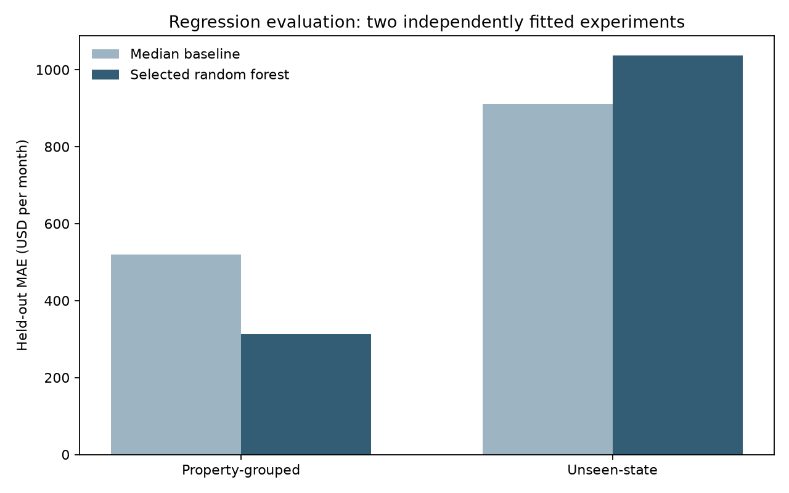
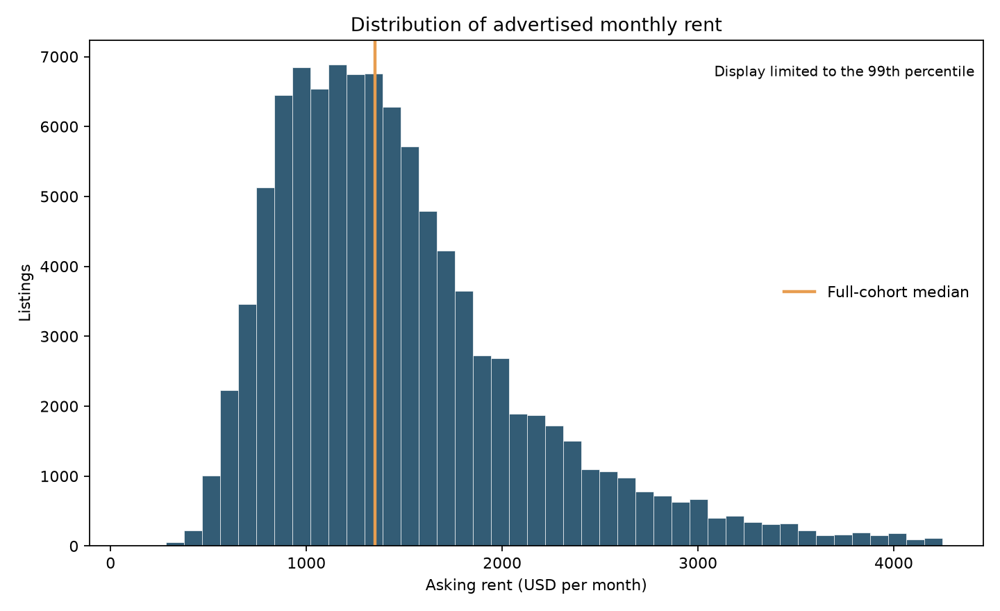
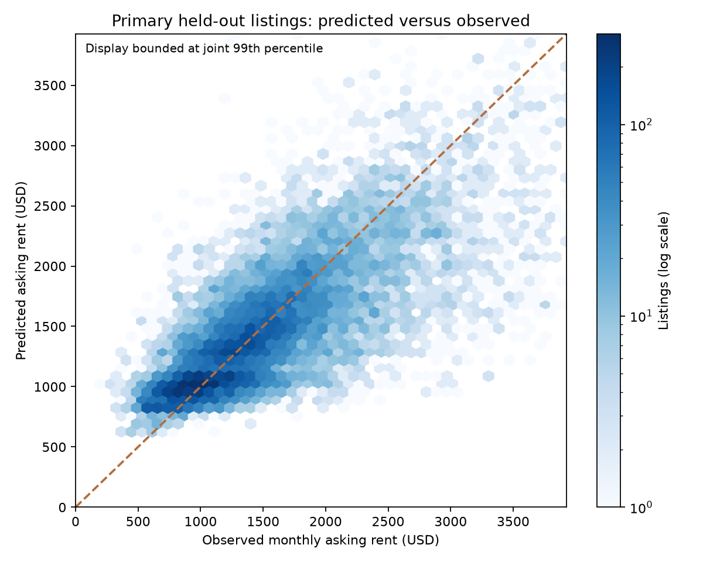
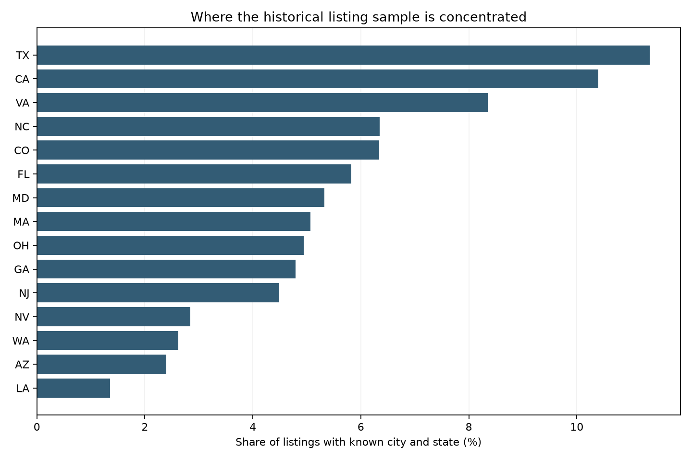
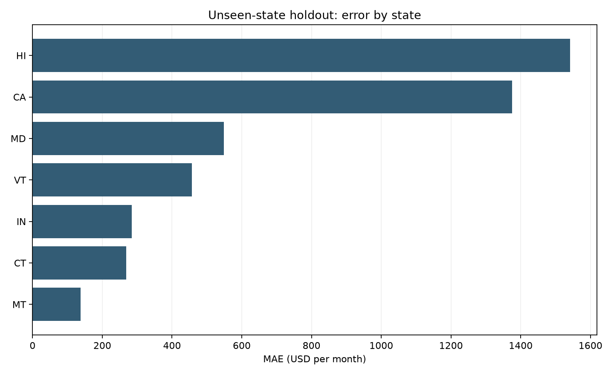

# The Rental Price Puzzle

**A historical US rental-listings study of price variation, property attributes, and model generalization**

*Real-estate analytics · CRISP-DM · 2018–2019 listings · Reproducible Python research*

**Author — Cyril James Lunzaga**

## Executive finding

Across **99,101** eligible listings with known city and state, a random forest trained using group-separated cross-validation estimated advertised monthly rent with **$312.37 MAE** on **19,905 held-out listings**, versus **$520.32** for the training-median baseline. This is a **40.0% reduction in average absolute error** on the primary evaluation. The median listed rent in the broader distinct eligible cohort was **$1,350/month**.

**Geographic transfer falls short on the preselected MAE criterion.** The forest's $1,036.30 error is 13.7% higher than the regional experiment's $911.14 median baseline. The geographic stress test withholds entire state codes, so the stronger primary result must **not** be generalized to previously unseen state markets. This contrast—not a claim of universally reliable rent prediction—is the project's main takeaway.



## The question

How much of the variation in historical **advertised asking rent** is associated with property size, room counts, listing features, and location? Can a model predict rents for listings separated from similar property specifications, and does the same model design transfer to **states excluded from training**?

We distinguish descriptive patterns from causal effects and model estimates from actual signed lease prices. No affordability or present-day US rental-index claim is made.

## Research design

The study follows a six-phase CRISP-DM workflow: problem definition, source understanding, data preparation, modeling, evaluation, and delivery. The original data source includes **99,492 records across 22 fields**; **99,487** meet basic monthly-USD positive-price and area conditions. Removing **84 exact row duplicates** leaves **99,403**, of which **99,101** contain both city and state. All retained high rents and large units remain in the primary analysis; the tail analysis is reported separately.

| Evaluation decision | Frozen protocol |
|---|---|
| Target | Historical advertised monthly asking rent, USD |
| Predictors | Square feet, bedrooms, bathrooms, category, state, city, photo, fee, pet-policy indication |
| Excluded | `price_display`, identifiers, listing text, addresses, source coordinates, timestamp, price-derived rent per sq ft |
| Selection | 3-fold training-only property-grouped cross-validation; minimum mean MAE |
| Candidates | Median baseline, regularized Ridge, Random Forest |
| Primary test | 79,196 training / 19,905 held-out listings; no matching property-group fingerprint across partitions |
| Geographic test | Independent refit on 82,247 listings from 43 state codes; 16,854 listings from 8 withheld codes |
| Transformations | Numeric imputation and category encoding fitted within training folds only; Ridge uses training-fold bounded quantiles |
| Outliers | No blanket rent or area winsorization in primary results; tail sensitivity reported separately |

The fingerprint of the frozen partition design is `eed0e59e56f4c457841a882f10af66d3828782b131f829b9e5c1627cfb3e135d`. Property grouping reduces near-specification leakage but cannot establish physical-unit identity. The geographic experiment is a stress test using a separate fitted model, not another score on the same estimator.

## Key numerical results

| Evaluation | Candidate | Holdout n | MAE (USD) | RMSE (USD) | R² |
|---|---|---:|---:|---:|---:|
| Property-grouped | Median benchmark | 19,905 | $520.32 | $970.16 | -0.034 |
| Property-grouped | Random forest | 19,905 | $312.37 | $628.83 | 0.565 |
| Unseen-state | Median benchmark | 16,854 | $911.14 | $1,674.89 | -0.333 |
| Unseen-state | Random forest | 16,854 | $1,036.30 | $1,644.82 | -0.285 |

The Random Forest was selected **before either held-out evaluation**, with training-only grouped-CV MAE of **$321.61**. Ridge was stabilized during training analysis before test scoring; the selected forest's specification was unchanged. Geographic Random Forest RMSE was **$1,644.82** versus **$1,674.89** for the baseline, but the MAE ranking reverses and both geographic R² values are negative. This mixed evidence matters: success depends on the metric and deployment population.

<details><summary>Training-only cross-validation results</summary>

| Candidate | Mean CV MAE (USD) | Mean CV R² |
|---|---:|---:|
| random forest log rent | $321.61 | 0.514 |
| ridge log rent | $336.86 | 0.414 |
| median baseline | $523.98 | -0.038 |

</details>

## Visual evidence

| Asking rents | Predictive fit |
|---|---|
|  |  |

| State concentration | Transfer to withheld states |
|---|---|
|  |  |

All charts are computed from the source data or aggregate evaluation artifacts. Distribution figures may limit the **display range** for readability; their displayed bounds do not remove high-price observations from the underlying analysis.

## Project assets and reading order

| Where | What to read or run |
|---|---|
| [`notebooks/01_market_context.ipynb`](notebooks/01_market_context.ipynb) | Audited cohort, missingness and market comparisons |
| [`notebooks/02_model_comparison.ipynb`](notebooks/02_model_comparison.ipynb) | Training-only CV, primary holdout and error reductions |
| [`notebooks/03_geographic_generalization.ipynb`](notebooks/03_geographic_generalization.ipynb) | Why unseen-state results limit the claim |
| [`market_study/`](market_study/) | Dedicated preparation, statistical, modeling, evaluation and release code |
| [`portfolio/tables/`](portfolio/tables/) | Reviewed, aggregate result tables |
| [`portfolio/reports/heldout_evaluation.md`](portfolio/reports/heldout_evaluation.md) | Extended final model evaluation |
| [`docs/portfolio_methodology.md`](docs/portfolio_methodology.md) | Research definitions, audit methods and evaluation interpretation |
| [`tests/`](tests/) | Unit tests and reproducibility/coverage gates |

## Reproduce the analysis

**Prerequisites:** Python 3.15 on Windows, Git, and the original UCI 100K source archive. Download the [dataset from UCI](https://archive.ics.uci.edu/dataset/555/apartment), extract `apartments_for_rent_classified_100K.csv`, and place it anywhere under `data/raw/`. Source CSV SHA-256 must equal:

`6adeae31e5507e39feb03acf811547a5331d2329c5a24ed1b1f1455fc1835916`

From the project root in PowerShell:

```powershell
py -3.15 -m venv .venv
.\.venv\Scripts\python.exe -m pip install --only-binary=:all: -r requirements.txt
.\.venv\Scripts\python.exe analysis.py
.\.venv\Scripts\python.exe -m pytest tests -q --basetemp=.venv/pytest-tmp
.\.venv\Scripts\python.exe -m market_study.verify_portfolio
```

`analysis.py` regenerates the research stages in order, including model training and the two held-out evaluations, then rebuilds the curated publication assets from verified evidence. Notebook sources run against the checked-in aggregate `portfolio/` tables and figures; no raw listing export is needed to read them.

## Interpretation and limitations

The original data are self-selected classified advertisements from **December 2018 through December 2019** rather than signed leases, comprehensive coverage, or current rental inventory. Missing amenities and pet-policy fields cannot be treated as explicit negatives. Source sampling is geographically uneven, and visually matching property specifications are not proof of identical underlying properties. This is a historical, observational prediction study; no causal price effect or policy recommendation follows from its association tests. The unseen-state result makes a general-purpose national price estimator inappropriate without further geography-aware development and independent validation.

**Conclusion.** On the frozen primary property-grouped holdout, a nonlinear model predicts historical asking rent substantially more accurately than a simple median. On geographically unseen state codes, its absolute-dollar error does not transfer comparably. The evidence supports a **scope-limited historical rental model**, not reliable prediction for unknown US states.

## Dataset attribution

Apartment for Rent Classified [Dataset]. (2019). UCI Machine Learning Repository. https://doi.org/10.24432/C5X623. Dataset page: [https://archive.ics.uci.edu/dataset/555/apartment](https://archive.ics.uci.edu/dataset/555/apartment). License: [Creative Commons Attribution 4.0 International](https://creativecommons.org/licenses/by/4.0/). The project applies original analysis and derived summary visualizations; the underlying UCI dataset is credited to its original contributors. Raw listings, addresses, individual predictions and row-level assignments are not included in this repository.

---

**Project author:** Cyril James Lunzaga
